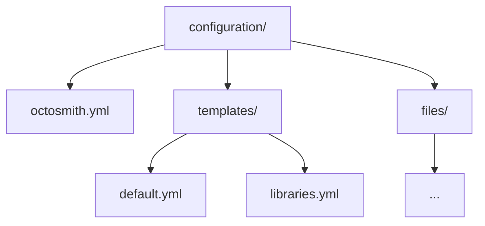

# Configuration

An Octosmith configuration directory contains one root configuration and one or
more repository templates. For the schema-driven file formats, start with the
[`octosmith.yml` reference](root-configuration.md) and
[repository template reference](repository-template.md). This guide explains
reconciliation semantics and operational behavior.



## JSON Schemas

The canonical schemas live at the repository root under
[`/schemas`](../schemas/):

- `https://raw.githubusercontent.com/Kralizek/octosmith/master/schemas/octosmith.schema.json`
- `https://raw.githubusercontent.com/Kralizek/octosmith/master/schemas/template.schema.json`
- `https://raw.githubusercontent.com/Kralizek/octosmith/master/schemas/fragment.schema.json`
- `https://raw.githubusercontent.com/Kralizek/octosmith/master/schemas/plan.schema.json`

For YAML editors that understand the YAML language-server directive, point each
file at the corresponding schema:

```yaml
# yaml-language-server: $schema=https://raw.githubusercontent.com/Kralizek/octosmith/master/schemas/octosmith.schema.json
```

Repository templates can use the template schema in the same way.

The published package contains generated copies so runtime validation remains
fully offline after JSR publication. The root `/schemas` files are the only
authored source; package-local copies are materialized during checks and release
packaging.

## Root configuration

`octosmith.yml` identifies the organization, repository scope, and collection
management mode.

```yaml
version: 1
organization: acme

repositories:
  scope:
    include: all

  settings:
    collection_management: explicit
    unmatched_repositories: ignore
    default_branch_drift: ignore
```

Repository scope may use names, teams, visibility, and custom properties. Name
selectors support `*` and `?` glob patterns.

`include` is required and may be either a repository selector or the literal
`all`. Use `include: all` when the scope starts from every repository and
`exclude` narrows it. `exclude` always uses the repository selector shape.

By default, every repository discovered in scope must match exactly one
template. `unmatched_repositories: ignore` leaves unmatched repositories
unmanaged. Use `unmatched_repositories: fallback` with a canonical
`fallback_template` identity to apply an ordinary repository template to
repositories without an explicit match:

```yaml
repositories:
  scope:
    include:
      teams:
        - cloud-services

  settings:
    collection_management: explicit
    unmatched_repositories: fallback
    fallback_template: repository:baseline
```

The referenced template can omit `match` when it is used only as a fallback. It
remains real managed desired state: its settings, permissions, rulesets, and
other declarations are reconciled normally. A fallback is not merged into
templates that match explicitly. Exactly one explicit match always wins, and
multiple explicit matches remain an error.

Review the scope carefully before applying a baseline that grants broad team
access. Scope exclusions are applied before matching; sensitive repositories
must be explicitly matched to an appropriate template or excluded from scope.

Use `octosmith resource list` to inspect the remaining in-scope resources and
their template matches. Ignored unmatched resources remain visible in inspection
and plan summaries. See the
[CLI reference](cli/resource-commands.md#resource-list) for text/JSON output and
exit behavior.

## Templates

Each repository in scope that is managed must resolve to exactly one template.
Regular template selectors are evaluated first. If none match, the configured
unmatched policy errors, ignores the repository, or selects the fallback
template. A fallback template may define `match`; that selector still
participates in regular matching, and the template can also be selected as the
fallback when no regular template matches.

Templates are discovered recursively under `templates/`. Their canonical
identity is `<kind>:<relative-path-without-extension>`, so
`templates/team-a/backend.yml` is `repository:team-a/backend`. The optional
`name` field is display-only and does not participate in identity.

A fallback-only template can omit `match` and compose fragments like any other
template:

```yaml
version: 1
kind: repository

includes:
  - ../fragments/repository-baseline.yml
  - ../fragments/default-branch-protection.yml

repository: {}
```

```yaml
version: 1
kind: repository

match:
  include:
    names:
      - "service-*"

repository:
  settings:
    has_issues: true

  teams:
    - name: platform
      permission: maintain

  files:
    CODEOWNERS:
      ensure: exact
      source: files/CODEOWNERS
```

Templates can manage repository settings, teams, custom properties, Actions
settings and values, Dependabot secrets, rulesets, environments, and files.

### Default branch and automatic initialization

`repository.settings.default_branch` remains an optional string:

```yaml
repository:
  settings:
    default_branch: develop
```

`plan` detects repositories without Git history and reports an initialization
operation without changing GitHub. `apply` initializes them automatically,
including repositories whose effective template has no managed files. The
initial branch is the explicitly declared branch, or `main` when omitted. That
fallback is used only for initialization and never becomes managed desired
state.

The root policy `repositories.settings.default_branch_drift` defaults to
`ignore`. On initialized repositories, `ignore` preserves the current default
branch even when the template declares a different branch. `enforce` corrects
drift only when the effective template explicitly declares `default_branch`. The
target branch must already exist; Octosmith never creates, renames, or deletes
branches to reconcile an initialized repository. Managed files use the preserved
default branch under `ignore`, or the explicitly enforced target under
`enforce`.

Bootstrap uses only GitHub APIs and does not require Git to be installed. The
Contents API creates `.github/.octosmith-bootstrap` in the first commit on the
selected branch. No README is created. The reserved file explains its purpose
and contains stable, versioned Octosmith ownership markers. Templates, including
fragments, cannot manage this path, even with `ensure: absent`. Unrecognized
contents produce an actionable conflict and are never overwritten or deleted.

Both boundary markers are the permanent ownership contract for the entire file,
not proof of who created it. Keeping both markers makes all enclosed content
eligible for cleanup, even if it has been edited or completely repurposed.
Octosmith deliberately does not match the explanatory prose, so legitimate
wording changes remain compatible across upgrades. Do not store user data inside
those markers. To repurpose the contents, move them outside the reserved path;
removing either marker instead causes a conflict and prevents automatic
deletion. Edits after planning still invalidate the reviewed SHA and saved-state
checks.

GitHub supports an explicitly selected initial branch through the Contents API,
but may retain its previously configured default branch in metadata. Octosmith
verifies the new root commit and owned file, updates the default through the
repository API when required, and verifies the final state. It never creates an
extra branch as a fallback. The credential needs Contents write and, when the
default needs completion, Administration write. API failures, including servers
that cannot establish the requested branch, are reported rather than bypassed.

With `repositories.file_changes.mode: direct`, the existing Git Data file
executor adds all desired files and deletes the bootstrap file in one subsequent
commit. Even a fileless template gets a cleanup commit, leaving an empty tree.
With `pull_request` (the CLI default), the initial commit contains only the
bootstrap file; the first managed-file PR removes it alongside desired changes.
A fileless template gets a cleanup-only PR. The file stays on the target branch
until the PR is merged. Repeated applies reuse the owned PR, and a PR closed
without merging can be recreated normally.

Bootstrap and initial file reconciliation precede Octosmith-managed protections.
Direct cleanup finishes before ruleset creates or updates. In PR mode, managed
ruleset changes are explicitly deferred until cleanup has merged; a later apply
installs them. This also applies to already initialized repositories still
containing the owned file. Unrelated initialized repositories keep normal order.
Existing repository and inherited organization policies remain active
throughout. If they block initialization or cleanup, their actual restriction is
reported. An administrator must provide policy-compliant intervention; no bypass
or temporary disabling is attempted.

Saved plans record explicit initialization, ownership and cleanup preconditions
and reject changed history, contents or commit SHAs. A saved empty-state plan
cannot initialize a repository another actor initialized. Regenerate a plan
after partial application: recognized bootstrap state resumes cleanup without
another first commit. If the first commit succeeded but default selection
failed, recovery verifies the same owned root commit and sole branch before
completing that selection. If cleanup succeeded but its response was lost, fresh
planning observes the completed state and does not repeat it. Pre-revision
bootstrap plans without a cleanup contract must also be regenerated; ordinary
legacy plans remain compatible.

GitHub's Contents API has no conditional "repository still has no history"
transaction. A concurrent first commit may cause a conflict or leave an
additional owned bootstrap commit; Octosmith detects non-root or changed-branch
results, does not overwrite user content, and stops before default changes or
protections. Inspect such races and create a fresh plan. There is no Git
subprocess fallback.

### Squash merge commit settings

GitHub supports these squash commit title/message pairs:

| `squash_commit_title`          | `squash_commit_message` |
| ------------------------------ | ----------------------- |
| `pull-request-title`           | `pull-request-body`     |
| `pull-request-title`           | `blank`                 |
| `pull-request-title`           | `commit-messages`       |
| `commit-or-pull-request-title` | `commit-messages`       |

Offline validation rejects explicitly invalid pairs. If only one setting is
configured, planning validates it together with the repository's current value
for the other setting. An invalid effective pair aborts apply before any
selected repository is mutated; Octosmith does not change an unspecified setting
to repair the pair. Configure both settings explicitly to resolve a conflict:

```yaml
repository:
  settings:
    merge:
      squash_commit_title: pull-request-title
      squash_commit_message: blank
```

### Creation and selector-required metadata

`resource create <template>` now creates an empty organization repository and
reconciles API-side resources. `--dry-run` remains completely offline/read-only.
Creation uses `repositories.scope` intersected with the selected template's
`match`, including excludes; unresolved name/visibility choices fail before
GitHub access. Teams and properties inferred by preflight are assigned and
re-read, then the actual repository must be in scope and uniquely classified.
Boolean selector properties use GitHub's string representation
(`"true"`/`"false"`). A selector `enabled: true` is compatible with a managed
custom property `enabled: "true"` (and likewise for `false`). Assignment,
selector intersection, creation preflight and classification use the same exact
representation; discovery preserves the strings returned by GitHub. Other
strings, numbers and arrays are not coerced into boolean matches. Multi-select
custom-property arrays compare without regard to order across selector matching,
intersection, preflight and reconciliation. Different values, lengths or
duplicate counts still differ; comparisons do not reorder inputs.

Required team membership initially uses read access; declared permissions are
then reconciled normally. With strict collections, explicitly declare required
teams/properties rather than configuring collections that would remove them.
Creation rejects a reconciliation plan that would invalidate classification.

Managed files remain part of composed configuration and are bootstrapped during
creation by one local Git commit/push, never Contents writes or file PRs under
either delivery mode. Default-branch changes, rulesets and archival
(`archived: true`) wait for the confirmed push and a fresh `github-only` plan;
archival runs last. Branch precedence is composed template, GitHub-resolved
organization default on the new repository, then documented `main`. Empty file
sets produce an empty commit without a placeholder. See
[creation and recovery](cli/resource-commands.md#resource-create). Ordinary
plan/apply still uses the existing initialization behavior above. An
already-satisfied `archived: false` is not pending work, and unarchiving is
allowed before bootstrap. Configured deferred work is retained on post-creation
failures, including missing runtime values and failed metadata/state reads;
deferred settings are labeled with their field names and reason in text output.

### GitHub Actions permissions

Actions permission settings (`allowed_actions`, `sha_pinning_required`, and
`selected_actions`) require an explicit `enabled: true` in the same
configuration block. `enabled: false` must not be combined with any of these
permission settings, even if a setting is `false` or an empty object. This is an
intentional tightening of configuration validation: existing permission blocks
without `enabled: true` must add it.

When `selected_actions` is specified, `allowed_actions` must either be
`selected` or omitted. If omitted, Octosmith infers `allowed_actions: selected`.

Valid examples:

```yaml
repository:
  actions:
    enabled: true
    sha_pinning_required: true
    selected_actions: # allowed_actions: selected is inferred
      github_owned_allowed: true
      verified_allowed: false
      patterns_allowed: ["acme/*"]
```

```yaml
repository:
  actions:
    enabled: false
```

Invalid examples:

```yaml
repository:
  actions:
    allowed_actions: all # Missing enabled: true
```

```yaml
repository:
  actions:
    enabled: false
    sha_pinning_required: false # Permissions cannot accompany enabled: false
```

```yaml
repository:
  actions:
    enabled: true
    allowed_actions: all # Must be selected or omitted with selected_actions
    selected_actions:
      github_owned_allowed: true
```

OIDC, secrets, and variables are independent of these permission constraints.
They do not require `enabled` and may also be configured alongside
`enabled: false`:

```yaml
repository:
  actions:
    oidc:
      immutable_subject: true
    secrets:
      - DEPLOY_TOKEN
    variables:
      - name: REGION
        value: eu-north-1
```

### Create-only bootstrap commands

Templates and repository fragments may declare an ordered executable list:

```yaml
repository:
  post_create_commands:
    - command: dotnet
      args: [new, editorconfig]
    - command: dotnet
      args: [new, globaljson]
  files:
    .editorconfig:
      ensure: exact
      source: files/.editorconfig
    obsolete.txt:
      ensure: absent
```

`command` is a required nonempty, non-whitespace string naming an executable (or
executable path). `args` is an optional array of strings, defaulting to `[]`.
Unknown fields, scalar command entries, conditions and environment declarations
are rejected during configuration loading. There is no shell mode, argument
interpolation, runtime-value expansion or command-specific configuration.
Arguments are passed literally, including spaces, `$`, `%` and shell
punctuation.

Commands execute **only** during actual `resource create`, after local Git
initialization and identity configuration, sequentially in the temporary
repository root. Plan, apply, inspection, validation and `--dry-run` never run
them or probe executable availability. The execution host must have the tools
installed and accessible on `PATH` (or use an explicit executable path).

Managed files are materialized **after all commands succeed**. Both `exists` and
`exact` overwrite command-generated files with their resolved declarative bytes;
`absent` removes generated output at that path. The final `.gitignore` applies
conventionally to generated files, but explicitly managed present files are
always included, even if ignored. Remaining generated regular files and managed
files enter the same single initial commit. All blobs bypass `.gitattributes`
filters and line-ending conversions, preserving on-disk bytes. Generated
executable bits are preserved on Linux; native Windows uses regular file mode.
Paths are checked against the same portable safety rules as managed files,
including ignored output. Symlinks, special files, case-colliding paths, unsafe
names and nested Git directories are rejected; root `.git` internals are
excluded. Commands must not modify Git metadata or create their own commits.

These are **trusted operator-supplied programs, not a sandbox**. They run with
the host user's filesystem/network privileges and can have external side
effects. Octosmith supplies an isolated environment: host `PATH` (plus
`SYSTEMROOT` on Windows), temporary `HOME`/`XDG_CONFIG_HOME`/temp directories
and bootstrap Git settings. It does not forward arbitrary host variables,
credentials or runtime secrets. Tools relying on host-specific environment
configuration may need an explicit executable path or operator setup.
Executables are launched directly, with no interactive input; stdout/stderr are
captured, not streamed.

A launch failure or nonzero exit stops the sequence immediately, with no
materialization, staging, commit or push afterward. Lifecycle failure
`post_create_command` reports only the one-based `failedCommand` ordinal, not
arguments or raw output. Temporary storage is cleaned up; the new remote is
retained and `pushAttempted` is false. Creation is nontransactional: external
command side effects are not rolled back. Correct the failure and initialize the
retained repository manually, then use ordinary plan/apply. Do not rerun create,
automatically retry commands or delete the remote. Preview shows ordered
executable names/count only; generated file counts remain unknown until
execution.

This list uses existing fragment precedence: nested includes first, includes in
declaration order, then the template. A later `post_create_commands` list
**replaces the whole earlier list**, preserving its own order; `[]` clears it.
Commands are never merged by executable name or appended implicitly.

### Fragment composition

Repository templates may compose reusable desired-state fragments with
root-level `includes`. Include paths are resolved relative to the document
declaring them, so fragments may include other fragments using paths relative to
their own location.

```yaml
version: 1
kind: repository

match:
  include:
    properties:
      type: backend

includes:
  - ../fragments/common.yml
  - ../fragments/dotnet.yml

repository: {}
```

Fragments are typed documents rather than partial templates:

```yaml
version: 1
kind: fragment
resource: repository

repository:
  settings:
    has_wiki: false
```

A fragment may contain only `includes`, which allows composition bundles. Empty
fragments are invalid. Repository templates still require their `repository`
payload; use `repository: {}` when all desired state comes from included
fragments.

Composition is deterministic. Objects merge recursively, and scalar values from
later inputs replace earlier values. Schema-defined named collections merge by
identity, preserving the order of inherited entries, replacing matching entries,
and appending new ones:

- `teams`, `rulesets`, and `environments` use their `name`.
- Actions, Dependabot, and environment `secrets` use the destination secret name
  (the string value or `to` in a renamed secret).
- Actions and environment `variables` use the destination variable name (the
  string value, `to`, or `name`).
- Rules within the same named ruleset merge by `type`, replacing a matching rule
  atomically rather than merging its parameters.

Matching rulesets and environments recursively merge their object fields. A
ruleset cannot change an explicitly inherited `target` to another target under
the same name: composition fails instead of inheriting potentially incompatible
conditions and rules. Matching teams, secrets, and variables replace the earlier
entry as a whole, so changing a variable from `from`/`to` to `name`/`value` does
not mix representations.

A document cannot declare the same identity twice in one named collection,
including nested environment secrets and variables. Validation reports the
collection path, duplicate identity, positions, and source file. Overrides
across different fragments and templates remain supported. A later empty named
collection (`teams: []`, for example) clears inherited entries.

Array replacement remains the default for paths without an explicit policy,
including OIDC claims and ruleset bypass actors. `post_create_commands`
explicitly uses whole-list replacement, not identity merging. Supported identity
merges are opted in by Octosmith itself; YAML authors do not configure merge
modes. A CI test requires an explicit decision for primary repository
collections and checks that registered paths exist. Nested arrays are opt-in: a
newly added nested array can retain the default replacement behavior without a
declaration. Includes are applied in declaration order and the local template is
applied last.

Nested includes are limited to 32 levels and must remain within the
configuration root after path canonicalization. Cycles are rejected across the
full include chain. If the same canonical fragment is reached repeatedly while
composing one root template, it is applied only at its first depth-first
occurrence. This de-duplication is scoped per root template, so the same
fragment can be reused by multiple templates independently.

Team permissions accept GitHub's built-in permission names. The user-facing
aliases `read` and `write` are normalized to GitHub's REST API values `pull` and
`push` respectively; custom repository-role names are preserved.

## Collection management

### explicit

`explicit` is the default. Undeclared collection members are preserved.

### strict

`strict` makes supported named collections authoritative. Undeclared members may
be removed.

Files are an exception: strict mode never infers file deletion. Deletion is
always explicit with `ensure: absent`.

## Runtime values

Variables may be read from environment variables, renamed, or declared with a
literal value.

```yaml
variables:
  - REGION
  - from: EXTERNAL_REGION
    to: REGION
  - name: STATIC_VALUE
    value: example
```

Secrets may be read or renamed but cannot be declared literally.

```yaml
secrets:
  - DEPLOY_TOKEN
  - from: SHARED_TOKEN
    to: DEPLOY_TOKEN
```

`template validate` remains fully offline: it validates reference shape and
reports runtime-backed values as warnings without reading their values.

`plan` resolves variables and checks secret availability only for resources and
templates participating in the current plan. Missing required values fail that
resource before current GitHub state is read. References used only by unmatched
templates do not fail planning.

Secret values are never materialized into desired state, reports, or plans.
`apply` resolves required secrets again immediately before mutation so a future
persisted plan can be applied safely in a different runtime context.

## Secret reconciliation

Secret reconciliation is `automatic` by default, including when the setting is
omitted. Opt out of routine secret updates in the root configuration:

```yaml
version: 1
organization: acme
repositories:
  scope:
    include: all
  settings:
    collection_management: strict
    secrets: manual
```

Only `automatic` and `manual` are valid. Manual mode excludes all Actions
repository secrets, Dependabot secrets, and environment secrets before runtime
input resolution. It requires no secret sources and generates no secret writes
or removals, even under strict collection management. Undeclared environments
containing secrets are preserved too, because deleting them would delete their
secrets. Other environment reconciliation, variables, and non-secret resources
continue normally. Reports give one policy warning without listing secret names.

For fresh `plan` and `apply`, `--include-secrets` or `--include-secrets=true`
opts secrets back in. `--include-secrets=false` is the same as omitting the
flag: it respects the configured mode, not a forced exclusion in automatic mode.
Only literal `true` and `false` are accepted as explicit values.

This is independent of `--skip-missing-values`: policy excludes every secret,
even available ones; missing-value handling applies only to participating
values. Once opted in, secrets follow the usual required-runtime-value checks
and `--skip-missing-values` behavior.

Saved plans retain their original exclusions and operations. During
`apply --plan`, the current secret mode and `--include-secrets` have no effect
on operation selection. Changing only the mode does not invalidate a plan;
actual configuration/template changes, state preconditions, and replay
dependency checks remain enforced. Required sources for saved secret operations
must still exist.

New persisted artifacts always use version 2, including plans with secrets
included. Version 2 introduces optional `secretsExcluded: true` on resources;
omission means secrets were not excluded by policy. Legacy version-1 artifacts
cannot contain that field and remain accepted without regeneration. Octosmith
does not automatically upgrade or replan existing artifacts. Both versions
replay saved operations independently of the current mode. Older Octosmith
releases may not read version-2 artifacts. This does not change the root
configuration's `version: 1`.

## Managed files

Managed file sources are local to the configuration root.

For `ensure: exact`, CRLF, LF, and lone CR line endings are treated as
equivalent when comparing text content. This normalization is comparison-only:
when a real update is needed, Octosmith uploads the desired source content
unchanged.

```yaml
repository:
  files:
    .github/dependabot.yml:
      ensure: exact
      source: files/dependabot.yml
```

File sources must stay inside the configuration root after canonicalization,
resolve to regular files, and satisfy the configured safety limits used by
offline validation.

## Validation expectations

Configuration is schema-validated before repository discovery. Octosmith also
checks that templates cannot overlap inside configured scope and that literal
repository names in scope can resolve to a template.

## File change delivery

Managed repository files are delivered through pull requests by default.
Omitting `repositories.file_changes` is equivalent to:

```yaml
repositories:
  file_changes:
    mode: pull_request
```

When `file_changes` is present, `mode` is required. An empty object is invalid.
Pull-request settings are only valid in `pull_request` mode.

```yaml
repositories:
  file_changes:
    mode: pull_request
    commit:
      message: "Octosmith: reconcile {repository}"
    pull_request:
      branch_prefix: "octosmith/"
      title: "Octosmith: reconcile {repository}"
      introduction: |
        Repository configuration is centrally managed.
        Please review the changes before merging.
      labels:
        - automation
```

Use `mode: direct` to opt into writing one reconciliation commit directly to the
default branch. Commit messages and pull-request titles support `{organization}`
and `{repository}` placeholders.

`introduction` is optional literal Markdown, not a placeholder template. It
belongs to the central configuration (`repositories.fileChanges.pullRequest` in
the TypeScript model), never to repository templates. It is written only on PR
creation. Subsequent applies preserve human-authored text outside the
`<!-- octosmith:files:start -->` / `<!-- octosmith:files:end -->` section. That
section lists the full sorted create/update/remove delta and Octosmith
attribution, without contents or diffs. Missing markers cause a section to be
appended; malformed or duplicate markers fail before branch mutation.

### Reconciliation lifecycle

The reserved `<branch_prefix>reconcile` branch is authoritative, not cumulative.
Each changed reconciliation has one commit based on the current target snapshot.
For example, successive desired states A, A+B, and B produce exactly those
managed changes, retaining unmerged changes that are still desired. Undeclared
target-branch files remain untouched. Manual commits on the reserved branch are
disposable.

When the complete desired delta is empty, apply closes the matching owned PR
with reason `no_differences`. This also works after removing all file
declarations or when a saved plan contains zero operations. No matching open PR
means no mutation. Missing inputs, stale targets, failed operations, and skipped
runtime bindings never trigger closure. Direct mode does not manage PRs.

Ownership requires the exact same-repository head and target plus an Octosmith
commit trailer or a valid managed body section. An unrelated or ambiguous PR,
unowned existing branch, or concurrently closed PR fails safely. Legacy branches
without ownership evidence are not adopted automatically: inspect and close the
old PR, then remove its reserved branch before running again.

Branch replacement atomically checks both target and reserved-head SHAs using
GitHub GraphQL `updateRefs`; it never force-updates the target. A temporary
`<branch_prefix>reconcile-lock` ref serializes Octosmith executions through PR
updates and closure. Conflicts are not retried against a competing head. Branch
protection that rejects these operations causes failure, not a blind fallback.

Closure resets the owned branch to a target-based empty-delta commit and retains
it for reuse; Octosmith does not delete reconciliation branches. The temporary
lock is deleted with an expected-SHA check. A cancelled run or indeterminate API
failure can leave a lock: verify that no apply is running, inspect both refs and
the PR, and have an operator remove only the abandoned lock before replanning.
Do not configure other automation to write these reserved refs.

GitHub does not provide a transaction spanning refs and PR metadata. Octosmith
rechecks the target before every successful no-op return and validates the
target, head, lock, and PR around lifecycle mutations. An already-correct PR is
reread before accepting a no-op; human body changes are preserved. Successful
mutation paths also validate PR state and target/head after releasing the lock,
so target advancement during cleanup cannot silently succeed.

Cleanup failures identify the reserved lock and retain any original failure.
Cleanup uses an expected-SHA deletion and never removes a competing lock. A
cancelled execution or ambiguous response can still leave the lock for operator
recovery. Failed PR operations do not fall through to automatic closure.

These checks establish correctness at their observations; they cannot prevent an
external writer from changing refs or PR metadata during an in-flight request or
after the final check. External writers do not honor the lock; avoid editing the
reserved refs during apply. Detected drift fails reconciliation, but already
executed GitHub side effects are not rolled back. A branch-only partial update
produces no PR lifecycle outcome. Validated PR actions remain reported if an
ancillary step or final validation later fails; see the
[event success contract](automation.md#event-streaming).

PR-mode planning snapshots the target commit even without file declarations.
Applying requires Contents and Pull requests write permissions for cleanup;
workflow changes and labels can need additional permissions. Use
`template permissions` for the complete configured requirements.
