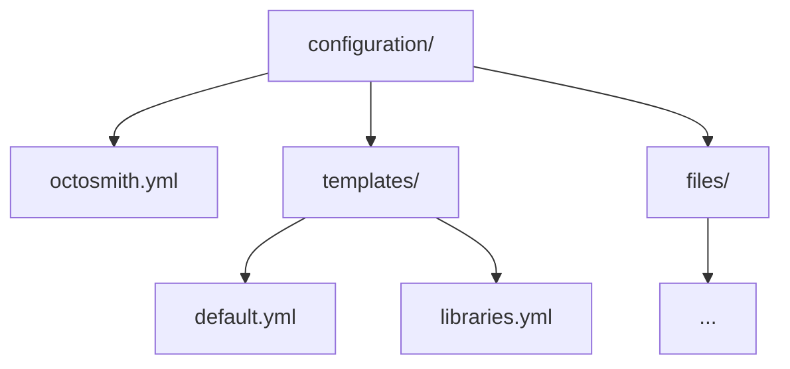

# Library configuration examples

These examples show the library's configuration model. The
[configuration reference](../configuration.md) is authoritative for supported
settings and reconciliation semantics.

## Configuration model

An Octosmith configuration directory has one root file and one or more
repository templates:



### Root configuration

`octosmith.yml` identifies the organization, repository scope, and collection
management behavior:

```yaml
version: 1
organization: acme

repositories:
  scope:
    include:
      names:
        - "service-*"

  settings:
    collection_management: explicit
```

Scope selectors can use repository names, teams, visibility, and custom
properties. Name selectors support `*` and `?` glob patterns.

### Repository templates

Every repository in scope must resolve to exactly one template. Regular template
matches take precedence; when none match, the configured unmatched policy can
select an explicit fallback template. Templates are discovered recursively and
identified as `<kind>:<relative-path-without-extension>`. The optional `name` is
display-only.

Example:

```yaml
version: 1
kind: repository

match:
  include:
    names:
      - "service-*"

repository:
  settings:
    has_issues: true

  teams:
    - name: platform
      permission: maintain

  files:
    .github/dependabot.yml:
      ensure: exact
      source: files/dependabot.yml
```

Repository templates can include reusable fragments, allowing common policy to
be composed without duplicating it across template files. Fragment composition
is resolved before validation, permission analysis, and desired-state planning.

A repository template can manage:

- repository settings
- teams and permissions
- custom properties
- GitHub Actions settings, variables, and secrets
- Dependabot secrets
- rulesets
- environments
- managed files

Configuration and templates are schema-validated before GitHub discovery.

## Collection management

`repositories.settings.collection_management` controls how supported named
collections are interpreted.

### explicit

`explicit` is the default. Only declared members are managed; undeclared members
are preserved.

```yaml
repositories:
  settings:
    collection_management: explicit
```

### strict

`strict` makes supported managed collections authoritative. Undeclared members
can therefore be removed.

```yaml
repositories:
  settings:
    collection_management: strict
```

Managed files are intentionally different: strict mode never infers file
deletion. A file is deleted only when it is explicitly configured with
`ensure: absent`.

## Runtime values and secrets

Variables may come from the process environment, be renamed, or use literal
configuration values:

```yaml
variables:
  - REGION
  - from: EXTERNAL_REGION
    to: REGION
  - name: STATIC_VALUE
    value: example
```

Secrets support environment lookup and renaming, but not literal values:

```yaml
secrets:
  - DEPLOY_TOKEN
  - from: SHARED_TOKEN
    to: DEPLOY_TOKEN
```

Secret values are not stored in configuration or reports. Before mutating a
repository, Octosmith resolves the secret values required by that repository; if
one is missing, that repository is not partially mutated first.

Fresh planning checks availability of participating secret sources without
storing their values. Set `repositories.settings.secrets: manual` to exclude all
secrets before preflight and desired-state construction. The core
`shouldIncludeSecrets(configuration, optIn)` helper computes fresh policy;
`resolveDesiredState` accepts the resulting `includeSecrets` decision. Persisted
replay restores the saved decision instead of consulting current policy. See
[secret reconciliation](../configuration.md#secret-reconciliation).

## Managed files

For `ensure: exact` or `ensure: exists`, `source` is a local file relative to
the configuration root.

```yaml
repository:
  files:
    CODEOWNERS:
      ensure: exact
      source: files/CODEOWNERS
```

Source files are confined to the configuration root and are bounded during
loading so offline validation can safely process untrusted pull-request
configuration.
