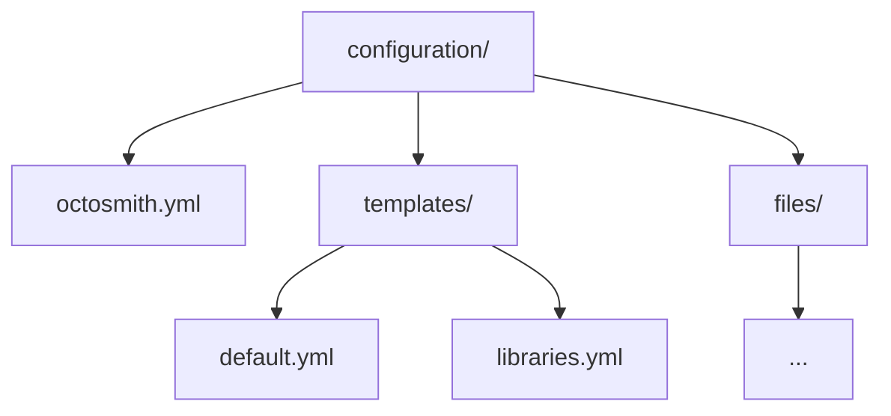

# @octosmith/octosmith

The Octosmith library package contains the configuration model, desired/current
state types, planner, reports, GitHub adapters, offline validation, and the
control-repository scaffolder.

Use this package when embedding Octosmith or when you need the configuration
model directly. For day-to-day command-line usage, use
[`@octosmith/cli`](../cli/README.md).

## Import

```ts
import {
  buildPlan,
  buildRepositoryCreationPreview,
  loadConfigurationDirectory,
  preflightRepositoryCreation,
  renderRepositoryCreationPreview,
  validateConfigurationDirectory,
} from "jsr:@octosmith/octosmith@0";
```

For example, validate a configuration directory without accessing GitHub:

```ts
await validateConfigurationDirectory("./configuration");
```

Prepare a repository creation without GitHub access or mutations:

```ts
const loaded = await loadConfigurationDirectory("./configuration");
const specification = await preflightRepositoryCreation(loaded, {
  template: "services",
  name: "api-service",
});
const preview = buildRepositoryCreationPreview(loaded, specification);
console.log(renderRepositoryCreationPreview(preview));
// Or serialize the same typed projection for automation:
console.log(JSON.stringify(preview));
```

`RepositoryCreationSpecification` is the validated input shared by preview and
execution. `buildRepositoryCreationPreview` takes that specification and the
**same loaded configuration** and projects the existing composed template
(fragments included) into a versioned `RepositoryCreationPreview`. It does not
re-run name generation, selectors, or classification, create another
desired-state model, or plan against fictitious current state. Keep the
specification as diagnostic output; the preview is a safe reporting projection,
not an executable plan. Each separate execution runs preflight once.

The builder and separate text renderer do not access GitHub, credentials,
runtime value providers, Git, or the filesystem. Preflight still performs normal
offline validation, including checking local managed-file sources. Preview
exposes paths and presence/absence, never file contents or variable/secret
values. Resource summaries describe resolved configured intent, not exact API
deltas; unconfigured categories are `not_applicable`. Name availability, remote
classification verification, precise reconciliation, and runtime values are
deferred. Template-managed default branches resolve offline; otherwise execution
must consult the organization default and then GitHub's documented fallback.
Generated preview names are provisional, unreserved, and never persisted;
callers must explicitly supply a name to preserve it across separate
invocations.

Failed preflight specifications produce an unresolved preview with the original
structured choices, diagnostic codes, and validation details, and no bootstrap
or resource plan. Hosts should return failure when `preview.ready` is false. The
CLI performs end-to-end creation without `--dry-run`. Post-create commands and
assisted choices are not implemented.

### Repository creation lifecycle

```ts
import {
  createRepository,
  FetchGitHubClient,
  LocalGitBootstrap,
  MissingRuntimeValueError,
  renderRepositoryCreationResult,
} from "jsr:@octosmith/octosmith@0";

const result = await createRepository({
  configuration: loaded, // Or a configuration directory path.
  template: "services",
  name: "api-service",
  visibility: "internal",
}, {
  client: new FetchGitHubClient({ token: Deno.env.get("GITHUB_TOKEN")! }),
  bootstrap: new LocalGitBootstrap({
    token: () => Deno.env.get("GITHUB_TOKEN")!,
  }),
  values: (name) => {
    const value = Deno.env.get(name);
    if (value === undefined) throw new MissingRuntimeValueError(name);
    return value;
  },
});
console.log(renderRepositoryCreationResult(result));
```

`RepositoryCreationRequest` and `RepositoryCreationResult` are reusable library
contracts. A lazy `client` factory can postpone authentication until preflight
succeeds. The validated name is resolved once, checked remotely, then submitted
unchanged to `createOrganizationRepository`, with only name, visibility and
`auto_init: false`. No README, license, Gitignore or commit is created. Required
teams/custom properties are assigned through the existing mutation sink and
actually re-read through discovery. Only an in-scope, unique match for the
explicitly selected template proceeds.

Creation reuses runtime-reference/secret policies, composed desired-state
resolution, `readCurrentState`, `buildPlan`, `applyPlan` and regular report
builders. The reusable `scope: "github-only"` option on the state reader,
planner/evaluations and mutation sink excludes GitHub file reads/delivery,
bootstrap operations and PR finishing without stripping files from desired
state. On empty history, default-branch changes, rulesets and archival
(`archived: true`) are deferred until Git bootstrap; API settings, teams,
properties, Actions, Dependabot and environments otherwise reconcile normally.
The result exposes safe deferred targets/reasons, not executable operations or
secret/file contents.

Configured deferred targets are recorded immediately after repository creation
so metadata, runtime-value and state-read failures preserve bootstrap recovery
information. Unarchiving remains applicable before bootstrap, and an
already-satisfied `archived: false` is not reported as deferred.

`RepositoryGitBootstrap` is an injectable library transport; `LocalGitBootstrap`
uses a temporary workspace, exactly one initial commit and at most one push. It
consumes `DesiredFile[]` from **the same `resolveDesiredState` transformation
used by ordinary reconciliation**, after template/fragment composition and
runtime preflight. There is no second file resolver. Raw Git blobs avoid
attributes/ignore transformations; absent files are omitted, and no-files
repositories receive an empty commit. The commit identity is
`Octosmith <octosmith@users.noreply.github.com>` for both author and committer,
and its message is `Initial repository bootstrap`.

Branch precedence is template `default_branch`, GitHub's organization/enterprise
default exposed as the new repository's `default_branch`, then documented
`main`. No extra organization API permission or invented branch policy is
needed. That resolved branch is explicitly pushed and configured as default.
Re-read classification/history/current state and a fresh `github-only` plan
finish default-branch settings and rulesets, with archival last. Successful API
deltas are not replayed; confirmed opaque secret deliveries still present
remotely are preserved within this invocation. Ordinary plan/apply defaults
remain unchanged.

The default HTTPS transport obtains a token lazily from the host, using a static
temporary askpass helper and an isolated push environment. It never writes the
token to disk or includes it in URLs/arguments. Raw Git diagnostics are captured
and discarded; configuration, prompts, inherited credential helpers, hooks and
global/system Git settings are isolated. Git Contents: write and workflow
authorization are required independently of API creation permissions. Hosts can
inject authentication, Git execution and temporary-directory/cleanup services.
Tests use fake execution or local bare repositories, never real GitHub creation.

Lifecycle statuses distinguish `preflight_rejected`, `name_collision`,
`creation_failed`, `metadata_failed`, `classification_failed`,
`reconciliation_failed`, `bootstrap_failed`, `bootstrapped_not_reconciled`, and
`completed` (`awaiting_bootstrap` remains a legacy status in the type).
Completed stages, failed stage, metadata assignment outcomes and the URL are
preserved when available. Reports exist only after normal reconciliation is
attempted. Repositories are never automatically deleted. Metadata/classification
failures may leave repositories outside discovery scope and require manual
repair; verified repositories can recover through ordinary plan/apply after
content and default-branch verification. `bootstrap` separately reports branch,
file count, preparation, commit creation/SHA, push attempt/confirmation, safe
failure category and cleanup failure. `push_unknown` explicitly means remote
changes may have occurred. `deferredReconciliationAttempted` and
`deferredReport` distinguish successful content delivery from complete creation.
Never rerun create for a retained repository; inspect uncertain pushes against
the SHA, repair content manually if needed, then create a fresh ordinary plan.
See the [CLI recovery guidance](../cli/README.md#resource-create).

`requiredPermissionsForRepositoryCreation` separates creation authorization,
selector metadata and API reconciliation permissions, without changing ordinary
permission analysis. See the
[permission guide](../../docs/automation.md#repository-creation-permissions).

For deeper guidance, see the repository documentation for
[configuration](../../docs/configuration.md) and
[architecture](../../docs/architecture.md).

Canonical JSON Schemas for configuration authors are published from the
repository [`/schemas`](../../schemas/) directory. See the
[configuration guide](../../docs/configuration.md) for editor integration.

## Configuration model

An Octosmith configuration directory has one root file and one or more
repository templates:



### Root configuration

`octosmith.yml` identifies the organization, repository scope, and collection
management behavior:

```yaml
version: 1
organization: acme

repositories:
  scope:
    include:
      names:
        - "service-*"

  settings:
    collection_management: explicit
```

Scope selectors can use repository names, teams, visibility, and custom
properties. Name selectors support `*` and `?` glob patterns.

### Repository templates

Every repository in scope must resolve to exactly one template. Regular template
matches take precedence; when none match, the configured unmatched policy can
select an explicit fallback template. Templates are discovered recursively and
identified as `<kind>:<relative-path-without-extension>`. The optional `name` is
display-only.

Example:

```yaml
version: 1
kind: repository

match:
  include:
    names:
      - "service-*"

repository:
  settings:
    has_issues: true

  teams:
    - name: platform
      permission: maintain

  files:
    .github/dependabot.yml:
      ensure: exact
      source: files/dependabot.yml
```

Repository templates can include reusable fragments, allowing common policy to
be composed without duplicating it across template files. Fragment composition
is resolved before validation, permission analysis, and desired-state planning.

A repository template can manage:

- repository settings
- teams and permissions
- custom properties
- GitHub Actions settings, variables, and secrets
- Dependabot secrets
- rulesets
- environments
- managed files

Configuration and templates are schema-validated before GitHub discovery.

## Collection management

`repositories.settings.collection_management` controls how supported named
collections are interpreted.

### explicit

`explicit` is the default. Only declared members are managed; undeclared members
are preserved.

```yaml
repositories:
  settings:
    collection_management: explicit
```

### strict

`strict` makes supported managed collections authoritative. Undeclared members
can therefore be removed.

```yaml
repositories:
  settings:
    collection_management: strict
```

Managed files are intentionally different: strict mode never infers file
deletion. A file is deleted only when it is explicitly configured with
`ensure: absent`.

## Runtime values and secrets

Variables may come from the process environment, be renamed, or use literal
configuration values:

```yaml
variables:
  - REGION
  - from: EXTERNAL_REGION
    to: REGION
  - name: STATIC_VALUE
    value: example
```

Secrets support environment lookup and renaming, but not literal values:

```yaml
secrets:
  - DEPLOY_TOKEN
  - from: SHARED_TOKEN
    to: DEPLOY_TOKEN
```

Secret values are not stored in configuration or reports. Before mutating a
repository, Octosmith resolves the secret values required by that repository; if
one is missing, that repository is not partially mutated first.

Fresh planning checks availability of participating secret sources without
storing their values. Set `repositories.settings.secrets: manual` to exclude all
secrets before preflight and desired-state construction. The core
`shouldIncludeSecrets(configuration, optIn)` helper computes fresh policy;
`resolveDesiredState` accepts the resulting `includeSecrets` decision. Persisted
replay restores the saved decision instead of consulting current policy. See
[secret reconciliation](../../docs/configuration.md#secret-reconciliation).

## Managed files

For `ensure: exact` or `ensure: exists`, `source` is a local file relative to
the configuration root.

```yaml
repository:
  files:
    CODEOWNERS:
      ensure: exact
      source: files/CODEOWNERS
```

Source files are confined to the configuration root and are bounded during
loading so offline validation can safely process untrusted pull-request
configuration.

## Main API areas

The package's default export surface includes:

- configuration loading and offline validation
- selector matching and desired-state resolution
- desired/current state models
- plan construction and operation types
- structured reports and text rendering
- GitHub discovery and state readers
- GitHub mutation sinks and apply helpers
- resource inspection and template classification
- worst-case GitHub permission analysis
- persisted-plan creation, validation, and preflight helpers

The package intentionally contains the reusable engine. CLI argument parsing,
console output selection, and Hooksmith event serialization live in
`@octosmith/cli`.

## Scaffold a control repository

The package also exposes `./create` for `deno create`:

```sh
deno create jsr:@octosmith/octosmith@0 github-config -- --organization acme
```

Useful options are:

- `--collection-management <explicit|strict>`
- `--default-branch <name>`
- `--no-workflows`
- `--event-streaming`

The generated repository starts scoped to itself so the initial apply cannot
unexpectedly manage an entire organization. Its README includes the current
`template validate`, `template permissions`, `resource list`, `plan`, and
`apply` workflows, including template-scoped plan/apply examples.

`include` is required and may be either a selector or the literal `all`. Use
`include: all` when the scope starts from every resource and only `exclude`
narrows it.
